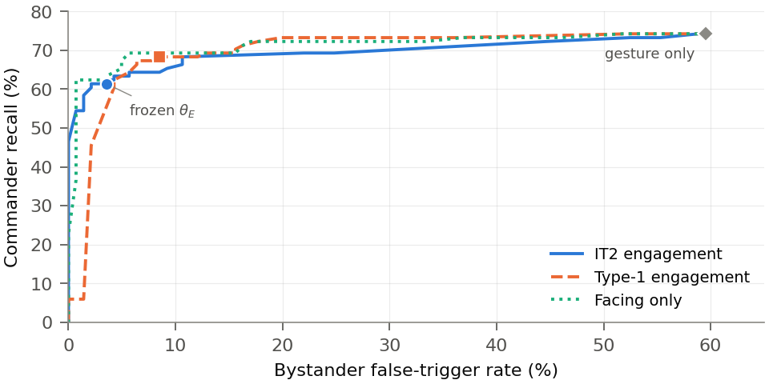
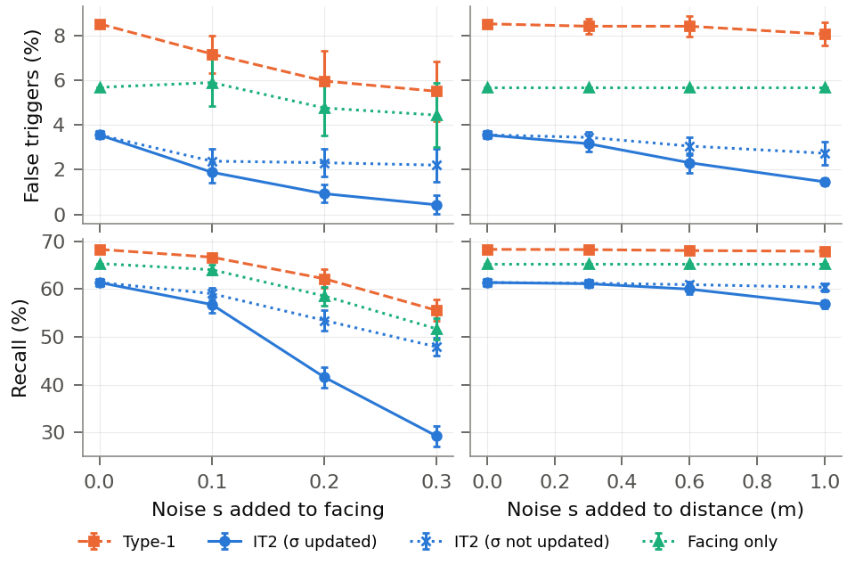

# Go2 engagement gating: progress and results (5 Nov 2026)

**Per-person engagement gating cuts bystander false triggers from 60% (gesture only) to 4–9%, while keeping
61–68% of real commands.** The IT2 gate is not more accurate than a tuned facing threshold; it acts as a fail-safe
that gets stricter when perception is uncertain. All numbers come from 14 stationary takes (17.4 min, 101
robot-directed and 141 bystander gesture episodes), evaluated offline with parameters frozen before recording.

Every number below comes from a file in `engage/results/`, produced by the scripts named in the last section.

## Work done

| # | Task | Result | Status |
|---|---|---|---|
| 0 | Setup: Python env, git repo, private GitHub backup | `engage/.venv`, `github.com/Himasara02/go2-engagement` (private) | Done |
| 1 | Reproduce the handover numbers | Exact match: gesture-only 60% / 74%, IT2 4% / 61% | Done |
| 2 | Evaluation protocol | `results/protocol.md`: all takes are test data; learned baselines leave-one-take-out | Done |
| 3 | Missed commands + perception recall | 15 commands never detected; perception recall 87% | Done |
| 4 | Baselines: facing-only, distance-only, logistic regression | Facing-only and LR match IT2 | Done |
| 5 | Statistics: Wilson, McNemar, bootstrap over takes | IT2 vs Type-1 is a trade-off (p = 0.016 both ways) | Done |
| 6 | Analysis: θ_E sweep, σ split, ablations, FOU k, noise | IT2 only changes decisions when σ is high | Done |
| 7 | Perception: full frame vs per-person crop | Crops find 4× more command gestures | Done |
| 8 | Distance sources | Depth reads 0.1–0.3 m long; monocular off by 1–11 m | Done |
| 9 | Gaze as a 4th input + monocular distance | Gaze-only 4% / 68%; IT2 + gaze 2% / 59%; monocular unusable | Done |
| 10 | Paper figures and tables | 3 figures + 7 LaTeX tables, generated from results | Done |
| 11 | Write the paper text | 21 placeholders left | Next |
| 12 | Final check + Overleaf zip | Zip of the current state made: `paper_overleaf.zip` | After 11 |

## Dataset

Recorded 28 Oct (day 1) and 30 Oct (day 2) with an Orbbec RGB-D camera on the Go2 (1280×720 @ 30 fps), dog
stationary. Labels by one annotator (A); `r` = for the robot, `n` = not, `x` = bad detection.

| Scenario | What happens | Takes | Min | r | n | x | Missed |
|---|---|---|---|---|---|---|---|
| S1 | single commander | 4 | 4.5 | 36 | 0 | 1 | 1 |
| S2 | bystanders gesture to each other | 2 | 2.9 | 27 | 33 | 10 | 0 |
| S3 | simultaneous gestures | 2 | 2.6 | 15 | 71 | 0 | 7 |
| S4 | commander turns to a friend | 2 | 2.7 | 4 | 6 | 0 | 3 |
| S5 | two commanders | 2 | 2.3 | 8 | 1 | 0 | 0 |
| S6 | bystanders walk past | 2 | 2.4 | 11 | 30 | 0 | 4 |
| **Total** | | **14** | **17.4** | **101** | **141** | **11** | **15** |

No walking takes (W1–W3) exist, so the paper reports stationary results only.

## Main results

False triggers = share of bystander gestures a policy would obey (lower is better). Recall = share of real commands
it obeys (higher is better). 95% Wilson intervals in brackets. † = threshold or model fitted leave-one-take-out.

| Policy | False triggers | Recall | Recall incl. missed |
|---|---|---|---|
| Gesture only | 60% (84/141) [51–67] | 74% (75/101) [65–82] | 65% |
| Nearest person | 27% (38/141) [20–35] | 30% (30/101) [22–39] | 26% |
| Facing only † | 6% (8/141) [3–11] | 65% (66/101) [56–74] | 57% |
| Distance only † | 56% (79/141) [48–64] | 58% (59/101) [49–68] | 51% |
| Logistic regression † | 4% (5/141) [2–8] | 62% (63/101) [53–71] | 54% |
| Type-1 fuzzy | 9% (12/141) [5–14] | 68% (69/101) [59–77] | 59% |
| **IT2 fuzzy** | **4% (5/141) [2–8]** | **61% (62/101) [52–70]** | **53%** |

- Any engagement gate (fuzzy, facing, or learned) removes most bystander false triggers.
- Facing is the cue doing the work: logistic-regression weight +3.5 for facing vs −0.6 for distance.
- Distance alone fails because 96 of 101 real commands came from 2–3 m: distance hardly varies in this data.

## Statistics

IT2 against each policy on the same episodes: episodes only IT2 accepts / only the other accepts, exact McNemar
p (Holm-corrected), and bootstrap 95% interval (10,000 resamples of takes) of IT2 minus the other, in points.

| IT2 vs | Bystander: only IT2 / other | p | Robot: only IT2 / other | p | Δ false triggers | Δ recall |
|---|---|---|---|---|---|---|
| Type-1 | 0 / 7 | 0.047 | 0 / 7 | 0.062 | −14 to 0 | −19 to −1 |
| Gesture only | 0 / 79 | <0.001 | 0 / 13 | 0.001 | −64 to −42 | −29 to −4 |
| Nearest person | 4 / 37 | <0.001 | 33 / 1 | <0.001 | −33 to −10 | +8 to +56 |
| Facing only | 0 / 3 | 0.50 | 0 / 4 | 0.38 | −7 to 0 | −9 to −1 |
| Distance only | 1 / 75 | <0.001 | 12 / 9 | 1.00 | −63 to −35 | −22 to +29 |
| Logistic regression | 1 / 1 | 1.00 | 0 / 1 | 1.00 | −1 to +3 | −4 to 0 |

Every episode IT2 accepts, Type-1 also accepts: IT2 is a stricter Type-1, trading 7 bystander triggers for 7
real commands.

## Where IT2 helps

**IT2 changes decisions only when the measurement is uncertain.** Episodes split at the median measured σ:

| Episodes | Type-1 false triggers / recall | IT2 false triggers / recall |
|---|---|---|
| Low facing σ | 1% / 75% | 1% / 75% (identical) |
| High facing σ | 15% / 60% | **5%** / 46% |
| Low distance σ | 1% / 73% | 0% / 71% |
| High distance σ | 18% / 65% | **8%** / 55% |

- **θ_E sweep:** at a false-trigger budget of 2% or less, IT2 keeps 58% recall vs 6% for Type-1; facing-only
  keeps 62%. At 5% and above all three are within a few points.
- **Ablations:** facing alone gives the same result as all inputs (IT2 4% / 62%); distance alone fails (4–6%
  recall); approach adds nothing.
- **FOU scale k** (0, 0.5, 1, 2): false triggers 9 → 5 → 4 → 1%, recall 68 → 64 → 61 → 55%. A clean trade-off;
  k = 0 is Type-1.
- **Noise injection** (facing noise 0.3, 20 seeds): IT2 told the noise 0.4% / 29%; Type-1 5.5% / 56%; facing-only
  4.4% / 52%. IT2 refuses more as uncertainty grows: a safety behaviour, at a recall cost.

## Perception

Running the hand detector on a square crop around each person (same people, IDs and frames) instead of the
whole frame:

| Takes | Command frames (full → crop) | Episodes (full → crop) | Commander frames (full → crop) |
|---|---|---|---|
| Day 1 (4 takes, 1–3 people) | 570 → 1160 | 23 → 75 | 544 → 955 |
| Day 2 (10 takes, 4 people) | 142 → 1681 | 11 → 178 | 33 → 382 |
| **All 14** | **712 → 2841** | **34 → 253** | **577 → 1337** |

Crops matter most in crowded takes. Bystanders' casual hands are mostly read as "call"/"mute" (93 + 27 of 141
bystander episodes), both meaning backward. "two_up" never appears.

## Distance

Depth on three calibration takes (one person at floor marks 1–4 m, median over takes):

| Mark | Bias | SD | Reported σ_d | Within σ_d (bias removed) | Person detected |
|---|---|---|---|---|---|
| 1 m | +0.14 m | 0.06 m | 0.12 m | 95% | 83% |
| 2 m | +0.13 m | 0.11 m | 0.10 m | 79% | 100% |
| 3 m | +0.20 m | 0.12 m | 0.10 m | 85% | 97% |
| 4 m | +0.30 m | 0.16 m | 0.30 m | 100% | 43% |

Depth reads 0.1–0.3 m long, partly the camera-to-mark offset. At 4 m the person is often not detected. Swapping
σ_d for the monocular model (0.15 + 0.08·d) or a fixed 0.45 m leaves IT2 at 3–4% / 61%.

## Gaze and monocular distance

Re-ran pose + face/iris detection on the raw videos (518 MB subset of the 31 Oct data, all 51 files checksum-verified).
Every logged person-frame was matched to its track ID (12,015 / 12,015); a face with iris was found in 63%.
Gaze rules (2 added rules, same membership functions as facing) were fixed before looking at results, but after
data collection, unlike the original 9 rules.

| Policy | False triggers | Recall |
|---|---|---|
| IT2 (reference) | 4% (5/141) | 61% (62/101) |
| **Gaze only** † | **4% (6/141)** | **68% (69/101)** |
| Type-1 + gaze | 8% (11/141) | 68% (69/101) |
| **IT2 + gaze** | **2% (3/141)** | 59% (60/101) |
| Type-1, monocular distance | 7% (10/141) | 67% (68/101) |
| IT2, monocular distance | 1% (1/141) | 49% (49/101) |

- **Gaze is the strongest single cue so far:** same false triggers as IT2 with 7 more commands obeyed.
- **IT2 + gaze has the lowest false-trigger rate of any policy (2%)**, but differs from IT2 on only 4 episodes
  (not significant). In S5 (two commanders) gaze-only keeps 88% recall vs 25% for IT2.
- **Gaze is clean when the face is visible:** on the calibration takes it reads 0.99–1.00 facing the camera at
  2–3 m and 0.00 when turned away. At 1 m the face is mostly cut off and gaze reads 0.
- **Monocular distance is unusable here:** biased +0.8 m at 1 m to +11 m at 4 m, with SD of 3–31 m; 8% of
  person-frames read over 10 m (max 189 m) when people stand side-on. IT2 reacts to the large σ_d by refusing
  more (recall 49%, p = 0.001 vs depth). This justifies the RGB-D camera.
- **Bug found:** a monocular distance above ~180 m overflows `math.exp` in `fuzzy.py`'s sigmoid and would crash
  the live system when depth is missing. Analysis caps it at 10 m; `fuzzy.py` itself is unchanged (needs your OK).

## Assessment

**The defensible claim:** per-person engagement gating makes gesture control usable around bystanders (60% →
4–9% false triggers), and an IT2 gate driven by measured uncertainty becomes stricter exactly when perception is
unreliable.

**Weaknesses a reviewer will raise:**

1. A facing threshold matches IT2; IT2 vs Type-1 is a trade-off, not a win.
2. Distance and approach contribute nothing in this data (everyone at 2–3 m). Gaze adds a little (IT2 + gaze 2%).
3. Small study: 14 takes, 17 min, 4 people, one lab; S4 has only 4 r / 6 n episodes.
4. Robot stationary; it never acted on the decisions.
5. One annotator; recall 61% (users repeat about 4 in 10 commands).
6. Close prior work: Muñoz-Salinas et al. 2005 (Type-1 fuzzy interest from distance and facing).

**Next steps, by value:** a second annotator for Cohen's κ (1–2 h) · gaze result, especially for S4 · a short
closed-loop test with the dog obeying the gate · more takes with people at varied distances · write the text
(task 11) and the final check (task 12), submit by 12 Nov. Gaze now gives the paper a cue beyond facing.

## Files

| What | Where |
|---|---|
| Code + results (private) | `github.com/Himasara02/go2-engagement` |
| Analysis scripts | `engage/task3_missed.py` … `engage/task10_paper_assets.py`, gaze: `task9_reperceive.py`, `task9_eval.py`, shared code in `engage/analysis.py` |
| All results (json + md) | `engage/results/` |
| Paper (LaTeX, figures, tables) | `paper/`; upload zip `paper_overleaf.zip` (not in git) |
| Main dataset | `takes_crop2` from the 3 Nov handover (checksums verified against the manifest) |
| Raw videos (518 MB subset, verified) | `~/go2/data_31oct_partial/` on Himasara's laptop |
